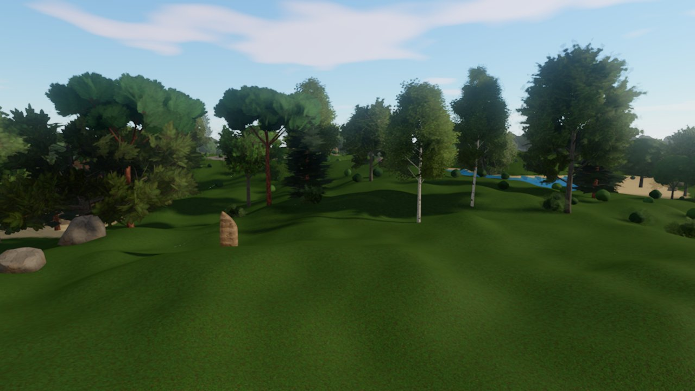

# Engine

A procedural 3D engine in Rust on [`wgpu`](https://wgpu.rs): large generated
worlds, destructible terrain and props, and a small, friendly API. You write
one closure that runs every frame; the engine owns the window, the GPU and the
render loop.



**What you get**

- **Rendering:** HDR with AgX tone mapping (ACES on request) and wide multi-level bloom, temporal anti-aliasing (4x MSAA optional), PBR materials
  (glTF metallic-roughness, normal, occlusion and emissive maps), three shadow
  cascades with soft filtering, SSAO, voxel-probe global illumination, a
  physical sky with day/night, clouds and weather, distance haze.
- **Big worlds:** grass blades grown on the GPU around the camera, per-instance LOD with dithered cross-fades, GPU frustum
  culling, an endless GPU clipmap terrain, chunk streaming, a floating origin
  for kilometre-scale coordinates, portals between separate spaces.
- **Generated assets:** ten tree species and shrubs that sway in the wind and
  turn with the seasons, four rock shapes, 61 tileable PBR texture layers
  (ground, cliffs, facades, roofs, paving, medieval), procedural surface
  materials, caves and landscapes.
- **Destruction:** smooth voxel terrain you can dig into (meshed on the GPU),
  and meshes that shatter into solid pieces that tumble and pile up.
- **Physics:** rigid bodies (Rapier) for any mesh: stacking, pushing,
  throwing, explosions, kinematic movers, floating and sinking in water,
  impacts for sounds, rays. Voxel and height terrain are colliders
  automatically, and stay right after digging.
- **Characters and models:** glTF/GLB loading with full materials, skinned
  animation with blending, Actors characters, AssetGenerator `.fmpk` prop packs.
- **Everything else a game needs:** keyboard and mouse input, a fly camera,
  collision and character movement, particles, ribbons and VFX, audio, and
  immediate-mode UI (egui).
- **Self-tuning:** one call picks a quality preset, another keeps a frame-rate
  target by trading detail for speed.
- **Safe by default:** bad input (NaN positions, broken meshes, oversized
  files) is an `EngineError`, never a silent glitch or a crash.

## Getting started

Run the starter scene, a landscape with a wood you can fly through:

```bash
cargo run --release -p starter
```

Right mouse + move looks around, WASD flies, Space/Ctrl go up and down, Shift
is fast, Esc quits.

### Your own project

Add the engine as a dependency. Optimising dependencies keeps debug builds
playable (the generators and the renderer are slow without optimisation):

```toml
[dependencies]
engine = { git = "https://github.com/ArndRosemeier/Engine" }

[profile.dev.package."*"]
opt-level = 3
```

The smallest program spawns a box and looks at it:

```rust
use engine::prelude::*;

fn main() -> EngineResult<()> {
    Engine::run("hello", |world, frame| {
        if frame.first {
            world.spawn(Shape::box_at((0.0, 0.5, 0.0), (1.0, 1.0, 1.0), rgb(220, 160, 100))?);
            world.spawn(Shape::box_at((0.0, -0.05, 0.0), (20.0, 0.1, 20.0), rgb(90, 120, 70))?);
            world.set_physical_sky(Some(PhysicalSky::at_hour(15.0)));
        }
        world.look_orbit((0.0, 0.5, 0.0), 6.0, frame.time * 20.0, 25.0);
        Ok(())
    })
}
```

The quickest real start is to copy [`examples/starter`](examples/starter) into
your project: it is about a hundred lines and shows terrain, scattering, LOD,
the sky, quality settings and the fly camera together.

## How it fits together

| Idea | What it is |
|---|---|
| `Engine::run(title, update)` | Opens the window and calls `update(world, frame)` once per frame. Return an error to stop. |
| `World` | Everything in the scene: entities, camera, lights, sky, terrain, settings. |
| `Frame` | This frame's `dt`, `time`, `fps`, window size, `first` (true once, for setup), `input` and `ui`. |
| `Mesh` | Geometry you build (`add_box`, `add_point`, `add_triangle`, ...) or get from a generator or `Model::load`. |
| `EntityId` | What `world.spawn(mesh)` returns: move it with `set_place`, remove it with `despawn`. |
| `Place` | Position, yaw, pitch, scale and tint of one entity or instance. |
| `LodLevel` / `LodId` | Detail levels of one model, drawn per instance by camera distance (`spawn_lod_at`). |
| `SpaceId` / `Portal` | Separate pockets of the world (a house interior) joined by portals. |
| `EngineResult` | Every fallible call returns one; use `?` inside the closure. |

Coordinates are metres, Y is up. Yaw is in degrees, 0 faces +Z and 90 faces +X.
Colours are sRGB (`rgb(220, 160, 100)`).

Import `engine::prelude::*` for everyday work. `engine::advanced` has the power
tools (`Volume`, `ChunkStreamer`, custom GPU fields).

### Common recipes

**Put a forest on the ground:** generate a model, scatter places, spawn with LOD.

```rust
let ground = HeightField::new(demo_terrain_rules());
let places = Scatter::new(1)
    .disc(0.0, 0.0, 300.0)       // where
    .spacing(10.0)               // how dense
    .density(0.6)                // clumps and clearings
    .scale_range(0.8, 1.2)
    .on_ground(|x, z| ground.height_at(x, z))
    .only_where(|x, z| !ground.sample(x, z).water)
    .places()?;
// Generating models is the slow part: build_all makes them on all cores.
let oaks = build_all(&[0, 1, 2, 3], |&v| tree_model(TreeSpecies::Oak, v))?;
for (tree, mine) in oaks.iter().zip(Scatter::split(&places, 4, 1)) {
    world.spawn_lod_at(tree.lod_levels(), &mine)?;
}
```

**Load a model:** `world.spawn_model(&Model::load_scene("assets/house.glb")?, Place::new(0.0, 0.0, 0.0))?`
spawns a glTF/GLB with all its materials (`Model::load` merges it into one
`Mesh` instead). Paths must lie under the working directory; `load_scene_with`
takes another root. Animated characters: `AnimatedModel::load`, then
`world.spawn_animated(model, place)` and `play_animation(id, "Walk")`.
Faces and other shape changes are morph targets: fill `AnimatedModel::morph_targets`
and each `SkinMesh::morphs`, then set weights any frame with
`world.set_morph_weight(id, "eye-left-closure", 1.0)` or `set_morph_weights(id, &weights)`
(up to 64 targets; the GPU blends them before skinning).

**Robots and machines of moving parts, with LODs:** make each part's levels
once (`part.simplified(0.2)` gives a lighter mesh with the same textures),
`let model = world.spawn_lod(levels)?`, and for every copy
`let thigh = world.spawn_lod_like(model, &[])?; world.attach_lod(thigh, hip_pivot, Place::default())?`.
The set follows its pivot as it moves, picks its level by distance and shares
the model's meshes and maps with every other copy; it goes when the pivot is
despawned.

**Lights that switch with the hour:** put emissive surfaces on a glow channel
(`SurfaceMaterial { emission: 1.2, ..SurfaceMaterial::DEFAULT }.on_glow_channel(3)`)
and switch the channel any frame with `world.set_glow_channel(3, strength, Some(colour))`:
windows that come on at dusk, neon that flickers, no mesh rebuilt. Fog volumes
with `grade_on_top(grade)` add their look to a base grade that changes with the
day instead of replacing it.

**Texture anything:** `texture_layer(NaturalLayer::RockFace).apply_triplanar(&mut mesh)?`
wraps a mesh in a generated PBR layer without UVs.

**Light and atmosphere:** `world.set_physical_sky(Some(PhysicalSky::at_hour(18.5)))`
drives sun, ambient light, fog and exposure. `set_wind(0..2)` and
`set_season(0..1)` move and colour the vegetation.

**Destruction:** `world.set_voxel_terrain(Some(VoxelTerrain::new(volume)))`
gives diggable ground (see `examples/voxel_destruction`);
`world.shatter(entity, impact_point, Shatter::default())?` breaks a mesh into
solid pieces; they become physics bodies that hit each other and sink away
after `keep_seconds`.

**Huge streamed worlds:** implement `WorldGenerator` (in `engine::stream`):
`height(x, z)` for the ground, optionally `density(p, ground)` for caves and
overhangs, `populate(tile)` for what stands on each tile, and `sea()` /
`water_level(x, z)` for water. Then
`world.set_stream(Some(WorldStream::new(my_world, StreamSettings::default())))?`
and the engine does the rest on worker threads, a little per frame so moving
never stalls:

- diggable voxel ground in blocks around the camera (3 x 3 blocks of 128 m by
  default). Digging works as usual; edits are kept when a block unloads, come
  back when you return and go into save files;
- height tiles from there to `view_distance` (6 km), coarser with distance,
  drawn with the voxel shader so far ground matches near ground;
- tiles (128 m) populated out to `content_distance` (1.2 km): in `populate`,
  `tile.place(model, place)` puts down a model (a LOD set you spawned once
  with `world.spawn_lod(levels)` and no places: every tile's copies share its
  meshes and GPU batches), `tile.spawn(mesh, place)` / `spawn_solid` a one-off
  mesh (with a collider), `tile.add_lamp(lamp)` a light. `tile.seed()` and
  `Scatter::rect` make this a few lines;
- a water simulation window that follows the camera and opens onto your sea,
  drawn on to the horizon.

GI, shadows, physics and navigation see the streamed ground like any other.
`world.prepare_stream(10.0)` on the first frame waits until the ground under
the camera is there; `stream.set_focus(Some(player))` loads around a player
instead of the camera; `stream.stats()` counts what is loaded;
`.with_terrain(|t| t.with_beach(2.0))` styles the ground. Coordinates stay
plain metres (fine for worlds tens of kilometres across). See
`examples/open_world`.

**Physics:** `world.add_body(id, Body::dynamic())?` and the entity falls,
collides and comes to rest; `Body::fixed()` for walls and floors (exact mesh),
`Body::kinematic()` for things you move with `set_place` (lifts, doors, a
sweeper) that shove others aside. Set `.density(0.6)` (relative to water: it
floats), `.friction()`, `.bounce()`, `.velocity()`, `.shape(BodyShape::Ball(r))`
and `.ccd(true)` for small fast things. Then `push`, `push_at`,
`set_body_velocity`, `blast(center, radius, speed)` for explosions,
`cast_ray(origin, dir, max)` for what's in the way (a body or the ground), and
`take_impacts()` each frame for hits worth a sound. Moving a body's entity with
`set_place` teleports it. The ground needs nothing: voxel or height terrain
becomes colliders around moving bodies (flat floor at y = 0 without terrain;
`set_physics_settings` changes that and gravity). See `examples/physics`.

**Physics without a window (game servers, tools, tests):** `PhysicsWorld::new()`
runs the same bodies, shapes and ground with no `World` and no GPU.
`add(&body, transform)` for boxes, balls and capsules, `add_mesh(&body,
transform, &mesh)` for hulls and triangle meshes, and you keep the returned
`BodyId` (send it as `id.raw()`). `step(dt)` runs the fixed steps that are due,
`step_once()` exactly one; read `transform(id)` (interpolated, for drawing) or
`pose(id)` (last whole step, for sending). Ground comes from
`set_height_terrain(HeightField)`, `set_height_fn(|x, z| ..)` or
`set_voxel_terrain(..)`. Built in the same order, it gives the same result as
the same scene inside `World`.

**Fixed simulation tick:** `world.set_sim_rate(Some(30.0))?` and every frame's
`frame.sim.steps` says how many fixed steps are due (`frame.sim.dt` long). Run
your simulation that many times; in each step call `world.begin_sim_step()`
and `world.set_sim_place(id, place)?` for what moved. The world draws those
entities between their last two steps (`frame.sim.alpha`), so a 30 Hz game
looks smooth at 144 FPS. A client that keeps previous and current state itself
calls `world.set_sim_poses(id, prev, cur)` instead. `Headless::new()` runs the
same update closure with no window or GPU (`frame(dt, update)` for one frame,
`run(HeadlessRun { .. }, update)` for a server loop). See `examples/fixed_tick`.

**Breakable buildings:** a building is a list of elements (wall panels per
bay per floor, slab tiles, columns, roof pieces, inner walls), each a box with
a strength. `BuildingPlan::tower(&TowerSpec { .. })` makes a generic one, or
add your own elements and their meshes with `BuildingPlan::add`. Textured
buildings: register each texture once with `plan.add_texture(albedo, maps)`
and give an element its meshes with `add_parts(element, &[(&mesh, Some(tex))])`
(`add_all` adds many elements in one go, so big towers plan in linear time);
broken buildings then keep their brick and stone, one draw call per texture,
and buildings with the same textures share them on the GPU. Share the
plan (`Arc`) and `world.spawn_building(plan, place)?`. Then
`hit_building(id, point, radius, power)`, `hit_buildings(..)`,
`break_building_elements(..)` and `cast_ray_buildings(..)`. Broken elements are
one bit each and the shaders hide them (no mesh upload). A storey that loses
half its support, or a whole side, fails: even damage pancakes the floors
above, one-sided damage topples them around a hinge; the falling part sheds
pre-fractured debris (a bounded pool that freezes into static rubble) and
leaves rubble mounds. `engine::building::Building` is the same state without
a window for the server: send `building.broken()` (`to_bytes()`), and
`world.apply_building_state(id, &bits, animate)` on a client gives the same
building and the same mounds. `PhysicsWorld::add_building` gives a server the
element colliders. See `examples/buildings`.

**Ragdolls:** `world.knock_down(id, Knock::new(impulse).at(point))?` on any
skinned character with a humanlike skeleton (Unreal, Mixamo, MakeHuman and
Rigify bone names). It goes limp from the pose it is drawn in (no pop) as 14
jointed bodies sized from its skeleton, tumbles, comes to rest (bodies
removed, pose kept), then gets up from the back or face down and blends back
into its animation. `.stay_down(true)` keeps it down until `world.get_up(id)`.
`world.ragdoll_state(id)`, `take_ragdoll_events()` (settled, got up),
`knock_down_in(center, radius, speed)` for blasts, `pick_character(..)` for
clicks, and `RagdollSettings { max_active, get_up_after, .. }`: beyond
`max_active` tumbling at once, the calmest one is settled. See
`examples/ragdolls`.

**Rooms (indoor culling):** describe interiors as rooms (boxes, optionally
rotated) joined by openings (doors, windows, holes):
`let r = world.add_room(Room::new(center, half), owner)?`,
`world.add_opening(Opening::rect(r, None, bottom_center, normal, w, h), open)?`
(`None` is the outside), then `world.set_room(entity, Some(r))` or
`set_room_by_position(entity)`. Each frame only rooms the camera can see
through open openings are drawn; buildings in front hide the rooms behind
them. `set_opening_open` changes an opening at runtime. Buildings made with
`spawn_building` get rooms and openings from their plan automatically
(`BuildingPlan::add_room`, `add_gap`; the tower preset has offices per floor):
windows are open, and a wall or door that breaks becomes a new opening.
`room_count()` and `set_room_culling(false)` to compare. See
`examples/interiors`.

**Reflections:** glossy surfaces (chrome, glass, wet streets, polished
floors) reflect what is around them. Screen-space reflections are on by
default (`set_screen_space_reflections(None)` or `Quality::Low` turns them
off): each glossy pixel traces its reflected ray through the last frame's
image, so the street mirrors towers and lamps. For what is off screen, add
reflection probes: `world.add_reflection_probe(ReflectionProbe::new(center,
half_extents))?` captures a cube map once and projects it onto that box
(a hall, a street), so a mirror inside shows the walls in the right place;
rough surfaces read blurrier mips. `.dynamic()` re-captures continuously,
`refresh_reflection_probe(id)` once (after a wall broke or the lights
changed); up to 8 probes, smaller boxes win where they overlap. Outside
every probe, surfaces reflect the sky. See `examples/reflections`.

**Decals:** `world.spawn_decal(Decal::new(DecalKind::Scorch, hit.point,
hit.normal, 1.5).on(hit.entity))?` paints a mark onto whatever is there:
terrain, walls, moving bodies and animated characters (it sticks to the
nearest bone). Built-in kinds are `Scorch`, `Crack`, `Frost`, `Impact`,
`Splat` (tint it) and `Power` (a glowing ring; tint and `.emission(..)`),
or your own image with `add_decal_image(rgba, w, h, roughness)`. Each one
changes albedo, normal, roughness and metalness, so scorch is matte and
dented and frost glossy. `.lifetime(s)` and `.fade(in, out)` make it fade;
the pool holds `set_decal_budget(n)` decals (256 by default, up to 512) and
the oldest make room. See `examples/decals`.

**Several moons:** `world.set_moons(vec![MoonSpec::new(2.2, 29.5, 0.38),
MoonSpec::new(0.8, 3.1, 0.27).tilt(-10.0).color(rgb(255, 150, 120))])?` gives
the physical sky up to four moons, each with its size, phase cycle (days),
starting phase, path tilt, brightness and colour. Each is drawn with its own
phase and surface, bigger ones in front; at night their light adds up, comes
from where the brightest stand and takes on their colours. An empty list
keeps the one usual moon. See `examples/moons`.

**Crowds:** `let crowd = world.add_crowd(model, CrowdProfile::new("idle",
"walk").walk_speed(1.2))?`, then `add_crowd_agent(crowd, place)?` per person
and `set_crowd_agent(crowd, agent, place, speed_mps)?` as they move. Far
agents are one instanced draw per mesh for the whole crowd, posed on the GPU
from the idle and walk clips baked into a texture (they walk or idle by
speed and cross-fade between the two), drawn with a mesh simplified to 5% of
its triangles (`.far_detail(f)`, or `.far_model(m)` for a ready-made one such
as Actors' "Crowd" level). The nearest (`.near(metres, max)`, 18 m and 24 by
default) become full characters at the same pose and step and go back the
same way; `crowd_agent_character` gives the stand-in to hit or decorate.
Extra clips named in `.poses(["sit", ...])` are baked too, and
`set_crowd_agent_pose(crowd, agent, Some("sit"))?` holds an agent in one
while it still moves with its place (people in cars, on benches); its
stand-in plays it too, without foot IK. See `examples/crowds`.

**Colour grading and fog by zone:** `world.set_color_grade(ColorGrade::warm())?`
sets the look of the image (exposure, contrast, saturation, white balance,
shadow and highlight tints, vignette; presets `warm`, `smog`, `cool`,
`bleak`). `world.add_fog_volume(FogVolume::new(center, half_extents)
.grade(ColorGrade::smog()).fog(rgb(128, 112, 84), 110.0).blend(40.0))?` gives
a district its own grade and fog. Inside the box's faces the look fades in
over `blend` metres, and it eases toward the camera's place over
`set_zone_transition(seconds)` (2.5 by default), so flying from one zone into
another blends over a few seconds with no pop. Overlapping volumes stack by
`.priority(n)`. See `examples/fog_volumes`.

**Lamps:** `world.add_lamp(Lamp::fire(pos))?`, `Lamp::street_lamp(pos)`, or
`Lamp::point(pos, color, intensity, range)` and
`Lamp::spot(pos, direction, angle_deg, color, intensity, range)` for your own;
add `.shadows(true)` and `.flicker(0.4)`. Move a carried lantern with
`set_lamp_position`, change anything with `set_lamp`, `remove_lamp` when done.
Hundreds of lamps are fine (each pixel only looks at the lamps that reach it);
shadows go to the lamps that matter most this frame, 4 by default
(`set_lamp_shadow_budget`, up to 8). Give bulbs and windows an emissive
`SurfaceMaterial` so they glow. See `examples/lamps`.

**Parents and prefabs:** `world.attach(wheel, cart, Place::new(0.8, 0.3, 1.0))?`
hangs one entity on another: it follows wherever the parent goes, and
`set_place` on a child is relative to its parent. `spawn_pivot(place)` is an
invisible handle to group things under; `attach_to_bone(sword, hero, "hand_r",
local)` and `attach_lamp_to_bone(lantern, hero, "hand_l", offset)` hold things
in a character's hand; `attach_lamp(lamp, entity, offset)` mounts headlights.
`set_parent`/`detach` keep things where they are on screen; despawning a parent
removes its children. A `Prefab` is a blueprint of named parts (meshes,
characters, pivots, lamps, bodies): `world.spawn_prefab(&cart, place)?` returns
the root plus `.part("wheel_fl")`; `register_prefab` + `spawn_named("cart",
place)` place it by name. A hull body wraps the parts hanging on it, so a
dropped cart tumbles on its wheels. `Place` now has a roll too
(`with_roll_deg`). See `examples/prefabs`.

**Save and load:** `world.save("slot1.save", &my_game)?` writes what changed
during play: every placed prefab (parts, bodies with their speed and spin,
animation clip and time), free-standing lamps and lamps riding on prefab
things, dug and built voxel terrain, the time of day, plus your own game data
(anything serde can write; `EntityId` included). To load, build the world as
at startup (terrain, scenery, `register_prefab` for every prefab), then
`let loaded = world.load("slot1.save")?; let game: MyGame = loaded.game()?;`
and map saved ids with `loaded.entity(old)`. `save_to_bytes` /
`load_from_bytes` work in memory. Derive with
`#[derive(engine::serde::Serialize, engine::serde::Deserialize)]` and
`#[serde(crate = "engine::serde")]`, or add serde to your crate. See K and L in
`examples/voxel_destruction`.

**Character animation:** switching clips cross-fades (0.2 s;
`set_animation_blend(id, seconds)`, 0 snaps). With an `AnimationProfile` that
says how fast the clips move (`.walk_speed(1.4).run_speed(3.2)`),
`set_locomotion(id, Locomotion::Moving { speed_mps })` plays walk or run at the
rate that matches the real speed and keeps the step phase when switching, so
feet don't slide or skip. `set_foot_ik(id, Some(FootIk::default()))` makes feet
stand on what is drawn under them (any mesh's upward faces, the terrain,
bodies): each sole is set on the surface even when the character's origin is a
few centimetres off (a game server's simpler floor) or the clip's soles sit
under its own floor; knees bend, hips follow the lower foot, feet keep their
tilt. Crowd characters close up get it too. `world.ground_below(p, depth)` asks
the same question for anything else; `set_walkable(id, false)` leaves grass
blades, glass or effects out; `sole_points(id)` says where both soles are, for
checks. Legs are found by bone name (UE, Mixamo, Blender rigs). See
`examples/characters`.

**Navigation (AI walking):** `world.build_nav(min, max, NavSettings::default())?`
works out where characters can walk: ground, floors, steps and bridges made of
fixed bodies, several levels above each other, kept a radius away from walls
and drops (about 10 ms for a 40 x 40 m village). `world.find_path(from, to)`
gives straight walkable segments. `world.add_nav_agent(id, NavAgent::new(1.4))?`
and `world.set_nav_goal(id, Some(pos))?` make an entity walk there by itself:
it turns, slows for corners, keeps apart from other agents, and plays its walk
and run clips. Check `world.nav_status(id)` (Moving, Arrived, Unreachable).
Voxel digging updates the walkable area by itself; after adding or removing
fixed bodies call `world.rebuild_nav_area(min, max)`. `world.nav_debug_mesh()`
shows it.

**Particles:** up to 262 144 particles, emitted, moved and drawn on the GPU.
Ready-made emitters: `ParticleEmitter::flames`, `smoke`, `embers`, `sparks`,
`dust`, `debris` (solid chunks that tumble, bounce and settle) and `fireball`;
change any of them with the `with_..()` setters.
`world.particles_mut().start(emitter)?` runs one until `stop(id)`, and
`burst(emitter)?` fires a one-off burst that needs no handle (impacts,
explosions). Smoke and dust are lit by sun and sky and fade softly into the
ground; `with_collision(..)` makes particles bounce off whatever is on screen.
`world.start_fire(pos, size)?` lights a fire (flames, smoke, embers and a
flickering lamp) and `world.explosion(pos, radius)?` sets one off.
Destruction makes its own dust and chunks: `world.dig(pos, r)`,
`world.shatter(..)` and `world.hit_building(..)` (turn it off with
`world.set_destruction_effects(false)`). Streamed tiles can carry effects too
(`tile.add_fire(..)`, `tile.add_effect(..)`). Particles run by themselves;
call `particles_mut().advance(dt)` only for slow motion or fixed steps.

**Input:** `frame.input.down(Key::W)`, `pressed(Key::Space)` (this frame only),
`mouse_down(MouseButton::Left)`, `move_xz()` for WASD, `mouse_delta()`.
`FlyCamera` does all of it for a free camera.

**UI:** `frame.ui` is an egui frame: panels, buttons, images, modals.

**Finding z-fighting (flickering surfaces):** run any app with
`ENGINE_ZFIGHT=1` and every place where two faces lie in the same plane and
overlap is marked with a glowing magenta post, with a list in the console
(where, which colours, which meshes). It scans again whenever the scene
changes. In code, `world.check_z_fighting()` does the same once,
`world.find_z_fighting()` returns a `ZFightReport` without marking anything,
and `world.set_name(id, "rug")` makes the report say "rug / floor" instead
of entity numbers. Keep generated content clean in a test, with no window:

```rust
let report = ZFightCheck::new()
    .options(engine::zfight::Options::ground_at(0.0)) // bottoms resting on the ground never show
    .with("house", &house_mesh)
    .with("ground", &ground_mesh)
    .run();
report.assert_clean(); // panics with the worst spots
```

Fix an overlap by lifting the face a centimetre or cutting the hidden one away.
Faces closer than 4 mm count (`Options::gap`); see `engine::zfight` and
`examples/zfight`.

### Sound

Sounds are placed in the world: they come from their direction, get
quieter and duller with distance, are muffled behind walls (a ray from the
camera, plus rooms), shift pitch when they move fast, and echo like the
space the camera is in. The engine works that space out by itself: open air,
a room or a hall (from `Room`s and their size), a cave (ground on most
sides) or under water (everything muffled).

```rust
let boom = Sound::load("assets/boom.ogg")?;               // wav, ogg, mp3, flac
world.play_sound_at(&boom, [10.0, 0.0, -30.0]);           // one-shot in the world
let engine = world.play_sound(&Sound::load("assets/motor.ogg")?,
    PlaySound::following(car).looped().range(3.0, 200.0));
world.play_sound(&click, PlaySound::ui());                 // straight to the speakers
world.stop_sound(engine, 0.5);                             // fade out over 0.5 s

// Music in layers that loop in step; intensity picks which ones play.
world.play_music(MusicTrack::new()
    .layer(Sound::load("music/pad.ogg")?)                  // always
    .layer_between(Sound::load("music/drums.ogg")?, 0.6, 0.8), 2.0);
world.set_music_intensity(0.9);                            // a fight: bring in the drums

world.audio_mut().set_bus_volume(Bus::Music, 0.5);
world.set_room_reverb(hall, Some(Reverb::HALL));           // instead of the guess from its size
```

No audio files needed to start: recorded explosions, crumbling, digging,
knocks, splashes and loops for fire, streams, rivers, surf and wind are built
in (`Sound::stock(Stock::Explosion, variant)`), and `Sound::explosion(seed)`,
`knock`, `fire_loop` and friends plus `MusicTrack::procedural(seed, bpm)` are
made in code. The engine also makes
its own sounds for explosions, digging, crumbling and shattering, fires,
splashes, hard impacts between bodies, and flowing water and surf near the
camera; `world.set_auto_sounds(false)` turns them off. See `examples/audio`.

### Quality and performance

```rust
world.set_quality(Quality::Medium);   // Low, Medium, High (default), Ultra
world.set_target_fps(Some(60.0))?;    // keep 60 FPS: pull LOD and grass in, then drop GI, then AO
world.set_vsync(false);               // uncapped frame rate (the title bar always shows FPS)
```

**Occlusion culling** (automatic by default): meshes and instances hidden
behind others, such as the blocks behind a street wall, are not drawn. In
`OcclusionMode::Auto` Engine tries it whenever 32 or more meshes are in view,
keeps it while it hides at least 15% of them, and switches it off where it
doesn't (open fields), trying again later and less often each time.
`world.set_occlusion_culling(true / false)` forces it on or off;
`world.set_occlusion_mode(...)` picks any of the three. Hills and voxel ground
count as occluders too. The
depth prepass draws what was visible a frame ago, a depth pyramid is built
from it, and the GPU tests every other mesh's box against this frame's depth,
so nothing pops in: a stale answer only costs speed. Shadow maps still draw
every caster (light bounce and reflections use them off screen too).
`world.occlusion_stats()` says how many meshes were tested and hidden.

**Render scale** (off by default): `world.set_render_scale(0.75)` draws the
scene at 75% of the window's width and height (56% of the pixels) and lets
the TAA pass upscale it, like FSR 2 or Unreal's TSR. Any value from 0.5 to 1.0
works. Depth, AO, reflections and occlusion shrink with it; bloom, tone
mapping and the UI stay at full size. A still view gathers nearly full detail
over a few frames. Worth it at 4K, where the GPU time per pixel dominates.

**Cached static shadows** (on by default): each sun cascade keeps a second
map with only the casters that don't move (meshes and instance batches
unchanged for half a second that don't sway in the wind, and voxel ground).
While none of them changes and the cascade stays put, it is copied in and only
moving things are drawn on top. `world.set_shadow_cache(false)` turns it off.

**Far shadows on alternate frames** (on by default): the near sun cascade is
drawn every frame, the middle and far ones take turns, so each frame draws two
shadow maps instead of three (about 40% less shadow work). A cascade not
drawn this frame is shaded with the matrix its map was drawn with, so its
shadows stay right, one frame old; it is drawn at once when the sun turns or
the camera moves a tenth of its radius. `world.set_shadow_cascade_refresh([1, 1, 1])`
draws all three every frame again.

**Shared mesh buffers** (automatic): every mesh's vertices and indices live
in a few large GPU buffers ("pages") instead of two small buffers each, as in
Unreal or Frostbite, and so do their instance transforms. A draw names its place in the page, so neighbouring
draws keep their bindings. A mesh's room goes back to its page when the mesh
is removed.

**Multi-draw** (automatic where the GPU supports it, which every Vulkan and
DX12 card does): the world pass and the depth prepass send their opaque
meshes as one `multi_draw_indexed_indirect` per texture and buffer page, the
per-mesh arguments in a GPU buffer. Meshes the occlusion test decides take
their arguments straight from its output. In occlusion_city the 1,697 towers
in view go out in 5 calls instead of 1,697, and the CPU spends about 2 ms less
per frame on the world. Shadow maps (sun cascades, their static cache and
lamps) draw their casters the same way. GPU-culled instanced props keep their
own draws.

**Texture arrays** (automatic where the GPU supports them; Vulkan and DX12
cards do): every mesh texture set sits in one material table, the four maps
of up to 4,096 materials in GPU texture arrays and their factors in a buffer.
Each instance carries its mesh's slot, so the multi-draws above no longer
split by texture, only by the sampler kind (baked albedo or imported
material). In occlusion_city with 16 facade textures
(`OCCLUSION_CITY_TEXTURES=16`) the towers go out in 5 calls instead of
1,696, with the same picture. Shadow cutouts (textured foliage casters)
still split by texture. `ENGINE_TEXTURE_ARRAYS=0` turns it off.

**GPU scene** (automatic with multi-draws): every opaque mesh lives on the
GPU as a row that stays there from frame to frame; the CPU writes a row only
when its mesh changes (moved, new, hidden by a room). Each frame the GPU
tests every row against the view, and against the depth pyramid when
occlusion culling is on, and writes the draw arguments itself: what was seen
last frame draws first, then the rest that turns out visible. The CPU no
longer sorts, uploads or reads back the candidates, and no longer walks
every mesh for the second depth pass. Where the GPU can (Vulkan and DX12
cards), it also decides how many draws each multi-draw issues: it packs the
visible meshes of each group together and counts them, so hidden meshes cost
no draw at all (`multi_draw_indexed_indirect_count`; `ENGINE_DRAW_COUNT=0`
draws every row, hidden ones with no instances). `ENGINE_GPU_SCENE=0` turns
the GPU scene off.

Finer knobs: `set_shadows`, `set_grass_scale`, `set_ambient_occlusion`, `set_global_illumination`,
`set_bloom`, `set_tone_map`, `set_haze`, `set_lod_bias`, `set_view_distance`.

Shaders never compile mid-game. Every render and compute pipeline is built
before the first frame, on all CPU cores at once; parts only some games use
(the clipmap ground, the GPU water simulation) build on worker threads at
launch and are ready by the time they show up. On Vulkan the compiled
pipelines are also saved to disk (`%LOCALAPPDATA%\Engine\pipelines` on
Windows, `~/.cache/engine/pipelines` on Linux), so the next launch skips the
driver compile. Nothing to call: it is automatic.

## Generators

| Module | Makes |
|---|---|
| `vegetation` | `tree_model(species, variant)`, `shrub_model(variant)`: three LOD meshes, wind, seasons |
| `rocks` | `rock_model(shape, seed)`: boulders, blocks, slabs, spires with LOD |
| `texgen` | `texture_layer(layer)`: 61 tileable albedo/normal/roughness layers |
| `scatter` | `Scatter`: deterministic places with clumping, ground snapping, filters |
| `stream` | `WorldStream` + your `WorldGenerator`: huge worlds streamed around the camera (diggable voxels near, height tiles to the horizon, populated tiles, water window) |
| `proc_terrain` | `ProcTerrain::gpu_clipmap`: endless terrain with lakes, painted with texgen layers (`with_layers(Some(TerrainLayers { .. }))`) and grown with grass (`with_grass(Some(Grass { height, density, distance }))`), `HeightField` to query it |
| `landscape` | `Landscape::new(seed)`: hills and caves as a mesh |
| `voxel_terrain` | Smooth, diggable voxel ground meshed on the GPU (`with_beach(top_y)` for sand along the sea) |
| `fracture` / `debris` | Shatter meshes into solid chunks |
| `physics` | `Body`, `BodyShape`, `PhysicsSettings`: rigid bodies on top of Rapier |
| `lamps` | `Lamp`: point and spot lights with shadows and flicker |
| `hierarchy` / `prefab` | Parent/child entities, bones, pivots; `Prefab` blueprints spawned whole |
| `save` | `World::save` / `load`: prefab things, bodies, lamps, dug terrain, your game data |
| `proc` | `Noise`, carving helpers |
| `props` | AssetGenerator `.fmpk` prop packs |

## Examples

```bash
cargo run --release -p <name>
```

| Example | Shows |
|---|---|
| `starter` | The template: terrain, wood, rocks, sky, quality presets, fly camera |
| `open_world` | An endless streamed world: continents, mountains, beaches, woods, huts and the sea to the horizon, generated around you as you fly (F very fast, click digs, B builds) |
| `island` | Everything together: a wooded island in an open sea with surf, characters on the beach, digging, swimming |
| `hello_mesh` | Building a mesh by hand (a little house) |
| `vegetation` | All tree species, shrubs and rocks in the wind |
| `lod_forest` | 12 000 trees with per-instance LOD |
| `sky_day` | A day passing under the physical sky |
| `texgen` | The texture layers (`ENGINE_TEXGEN_FAMILY=natural/ground/facade/roof/medieval`) |
| `voxel_destruction` | Digging terrain and shattering towers; K saves, L loads |
| `lamps` | A hamlet at night: street lamps, a camp fire, lit windows, a lantern walker and a sweeping searchlight, all casting shadows (L your own lantern, T shadows, N/M the hour) |
| `characters` | Walk, run and idle blending into each other, speed-matched; feet planted on stone steps by foot IK (I toggles IK, B blending) |
| `navigation` | Villagers find their own way around houses, walls, a fountain and crates and up stairs to a terrace; click sends everyone there, N shows the walkable area |
| `prefabs` | Carts built from parts driving with spinning wheels, a windmill turning its sails, a lantern carried in a hand; C drops carts that tumble whole, X removes them |
| `buildings` | A block of breakable towers: punch panels (click), blast (F), topple (T), pancake (P), rebuild (R) |
| `ragdolls` | People strolling about: click knocks one flying, F a blast; they tumble, settle and get up (K keeps them down, G gets everyone up) |
| `crowds` | A thousand people walking about a town square: far ones instanced and GPU-animated, near ones full characters (N: near characters on/off, F: far mesh) |
| `moons` | A night under three moons of different sizes, colours, cycles and paths (Space: time, arrows: hour and day, M: one moon to compare) |
| `fog_volumes` | Colour grading and fog by zone: the camera flies from a warm old town into a smog-choked factory district and back (T: transition time, G: volumes on/off) |
| `decals` | Scorch marks, cracks, frost, impacts, paint and glowing power marks sprayed on terrain, a wall, a sliding block and people walking by (click sprays, 1-6 pick the kind, B the budget) |
| `occlusion_city` | 2 000 towers and 4 000 lamps on a street grid: occlusion culling skips the ones hidden behind the first walls (`OCCLUSION_CITY_VIEW=street/roof/air`, `ENGINE_OCCLUSION=0` to compare) |
| `interiors` | A city block of office towers, every floor furnished (about a million triangles); from the street only the rooms you can see through windows are drawn (C toggles culling, I interiors, click punches a wall open) |
| `reflections` | A rain-wet street between glass towers at dusk mirrors lamps, windows and chrome spheres; a polished hall's chrome ball shows the hall from a reflection probe (R toggles SSR, P the probe) |
| `zfight` | The z-fighting finder: a yard with four classic mistakes marked with magenta posts; F shows the fixed yard |
| `fixed_tick` | A 30 Hz simulation drawn smoothly at any frame rate, next to the raw steps; I toggles interpolation, 1/2/3 change the rate |
| `physics` | Crates, a brick wall, dominoes, rolling boulders and a sweeper; throw balls (click), blow things up (F), shatter (X) |
| `model_viewer` | Any glTF/GLB or `.fmpk` file: `-- path/to/model.glb` |
| `animated_animal` | Skinned glTF animation |
| `infinite_walker` | Endless clipmap terrain with a walker |
| `portals`, `portal_pair` | Spaces joined by portals |
| `material_showcase` | Procedural surface materials |
| `particles` | A camp fire, a forge throwing sparks and explosions that dig craters and blow towers apart into dust and chunks (click: explosion, 1/2/3: sparks, dust, debris, F: fire) |
| `audio` | Sound: a camp fire crackling from its direction, a cave and a stone hall that echo differently, a bell muffled by walls, explosions, and music in layers (click: explosion, 1-4: music intensity, M: music, K: knock, F: fire) |
| `vfx_showcase` | Particles, ribbons and spell effects |
| `procedural_caves`, `populate_world`, `gpu_field_demo`, `ui_modal` | Caves, prop scattering, GPU density fields, UI |

`run_examples.py` (or `run_examples.bat` on Windows) opens a launcher with a button per example, plus ready-made variants (texture families, the Actors character, sunset, storm...). Add new variants to its `VARIANTS` list.

## Environment variables

Every program built on the engine understands these:

| Variable | Effect |
|---|---|
| `ENGINE_WIDTH`, `ENGINE_HEIGHT` | Window size (default 1920 x 1080) |
| `ENGINE_SCREENSHOT=out.png` | Save frame `ENGINE_SCREENSHOT_FRAME` (default 3) to a PNG and exit |
| `ENGINE_SCREENSHOT_WAIT=1` | Wait for `world.mark_ready()` before counting screenshot frames |
| `ENGINE_MSAA=4` | 4x MSAA on top of TAA (default 1 while TAA is on: TAA smooths edges and costs 10-15% less at 4K; 4 when `ENGINE_TAA=0`) |
| `ENGINE_TONEMAP=aces` | Tone-map with ACES instead of AgX (`world.set_tone_map(ToneMap::Aces)` in code) |
| `ENGINE_OCCLUSION=0`, `=1` or `=auto` | Occlusion culling off, on or automatic whatever the game set (`world.set_occlusion_mode`), to compare frame times |
| `ENGINE_RENDER_SCALE=0.75` | Draw the scene at that share of the window and upscale (0.5 to 1.0), whatever `world.set_render_scale` says |
| `ENGINE_MULTI_DRAW=0` | Draw every opaque mesh with its own draw call instead of multi-draws, to compare |
| `ENGINE_TEXTURE_ARRAYS=0` | Split multi-draws by texture instead of reading every texture through the material table, to compare |
| `ENGINE_GPU_SCENE=0` | Build the opaque mesh draws on the CPU each frame instead of keeping them on the GPU, to compare |
| `ENGINE_DRAW_COUNT=0` | GPU scene: draw every row (hidden ones with no instances) instead of letting the GPU count the visible ones, to compare |
| `ENGINE_SHADOW_CACHE=0` | Draw every sun shadow caster every frame (no static cache), to compare frame times |
| `ENGINE_SHADOW_REFRESH=1` | Draw every sun cascade every frame, whatever `world.set_shadow_cascade_refresh` says, to compare frame times |
| `ENGINE_OCCLUSION_CHECK=1` | Read every frame's occlusion answers back and compare them with the CPU copy of the test; prints mismatches (slow, for driver trouble) |
| `ENGINE_INSTANCE_SUBMIT=cpu` | Draw every instance from the CPU instead of culling instances per view and shadow cascade on the GPU (default `gpu`) |
| `ENGINE_TAA=0` | Turn temporal anti-aliasing off (`world.set_taa(false)` in code) |
| `ENGINE_PRESENT_MODE` | `fifo` (default, vsync), `fifo-relaxed`, `mailbox` or `immediate` (uncapped, to see the real frame rate) |
| `ENGINE_FRAME_STATS=1` | Print frame-time statistics every 2 s (average, worst, spread: judges smoothness) |
| `ENGINE_SMOOTH_DT=0` | Hand the raw frame time to `frame.dt` (by default it is smoothed so motion does not shake) |
| `ENGINE_FIXED_DT=0.016` | Every frame steps exactly this long, so two runs show the same frame (for picture comparisons) |
| `ENGINE_AUTOFLY=1` | `FlyCamera` flies ahead in a slow curve by itself (for smoothness and speed checks) |
| `ENGINE_GPU_PROFILE_EVERY=N` | Print GPU timings every N frames: shadow, AO, scene, water, TAA, post; plus a split of the scene pass (sky, land, grass, voxel, meshes, ...) where the GPU supports it |
| `ENGINE_HITCH_MS` | Log frames whose work is slower than this (default 33) to the file set with `World::set_hitch_log`: phases, game spans, Engine's slow steps, GPU uploads |
| `ENGINE_CPU_TRACE=1` | Print every 2 s where the CPU time of a frame went: game update, each world tick, renderer sync and drawing (average and worst ms) |
| `ENGINE_AUDIO=0` | Run silent: do not open a sound device |
| `ENGINE_LOG_PIPELINES=1` | Print how long pipeline building took, whether the disk pipeline cache was used, and the work time of the first 5 frames |
| `ENGINE_PIPELINE_CACHE=0` | Do not keep a pipeline cache on disk (`ENGINE_PIPELINE_CACHE_DIR=<dir>` moves it) |
| `ENGINE_WHATS_NEW=1` | Keep the "What's new" button in screenshot runs (`open` also opens the list) |
| `ENGINE_ZFIGHT=1` | Find z-fighting around the camera (250 m; a number sets the radius, `all` scans everything), mark it with magenta posts and print where it is |

The examples add their own (listed at the top of each `main.rs`).

## Versioning

The engine version starts at 0.001 and goes up by 0.001 with **every merge
into `main`**. The only place it lives is [`CHANGELOG.md`](CHANGELOG.md):
the newest `## <version> (<date>)` entry is the current version. The engine
reads that file at build time, so `engine::version()`, every window title
("starter - Engine 0.004 - 144 FPS") and the "What's new" button in the
bottom right corner always match it. A game hides the button with
`world.set_whats_new_button(false)` or places it itself with
`engine::whats_new_ui(ctx)`.

Before merging a pull request:

```bash
git fetch origin && git rebase origin/main
python tools/bump_version.py "What this merge brings, in plain words"
```

One entry per pull request, in words a game developer understands. If
another merge took your number while you were rebasing (a conflict at the
top of `CHANGELOG.md`), keep both entries and run
`python tools/bump_version.py --renumber` to move yours on top again. The
`version` check on every pull request and `cargo test -p engine` fail when
the version was not raised by exactly 0.001.

## Testing

```bash
cargo test -p engine                        # unit tests, no GPU needed
ENGINE_GPU_TESTS=1 cargo test -p engine     # also the GPU checks
cargo clippy --workspace --all-targets
```

Warnings are errors in this workspace. Screenshots work headless (for example
under Xvfb with a software Vulkan driver), which is how renders are checked
without a GPU.

## Materials in depth

There are two material systems:

- `SurfaceMaterial` is attached to ordinary meshes, props, cave meshes and
  authored profiles. Start with `SurfaceMaterial::STONE`, `WOOD`, `DIRT`,
  `GRASS`, `SAND` or `SNOW`, then use `with_seed`, `with_orientation` and
  `with_coverage` when the asset needs variation. `Mesh::new()` already
  carries `SurfaceMaterial::DEFAULT`. Texture maps (`MaterialMaps`) add albedo,
  normal, occlusion-roughness-metallic and emissive maps, by UV or triplanar.
- `TerrainMaterialDesc` is for streamed world-XZ terrain. Create the eight
  generated albedos with `World::create_terrain_albedo`, pass them to
  `TerrainMaterialDesc::from_albedos`, tune the descriptor, then call
  `World::create_terrain_material` and `set_default_terrain_material`. All
  handles are required: a missing one is an error, not a silent fallback.

For directional materials, `with_orientation([x, y, z])` gives the local axis
(wood grain is the usual case).

## Safety

- Bad mesh, colour or NaN input returns `EngineError`.
- Volume paints, glTF size and instance counts are capped (`EngineLimits`,
  adjustable with `Engine::run_with`).
- `Model::load` rejects paths outside an allowed root.
